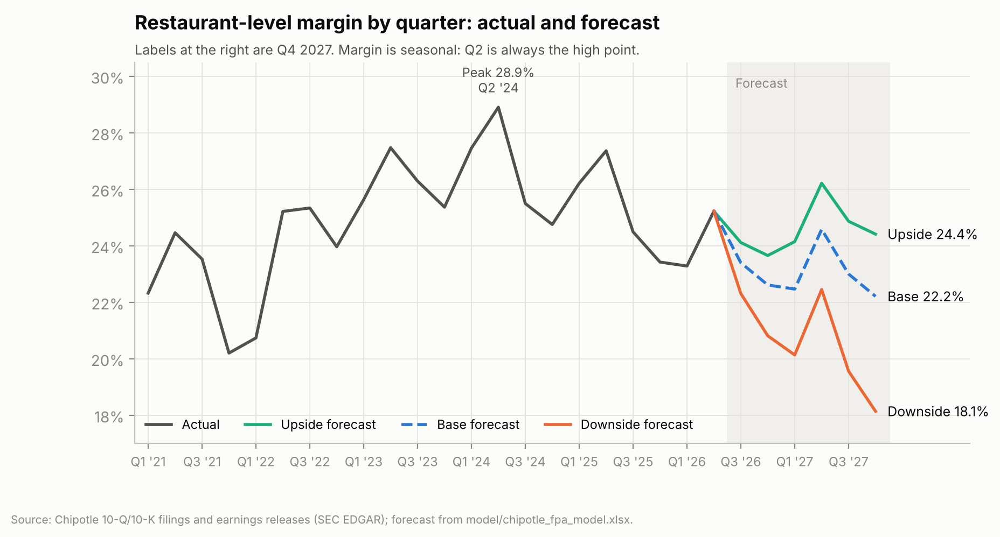
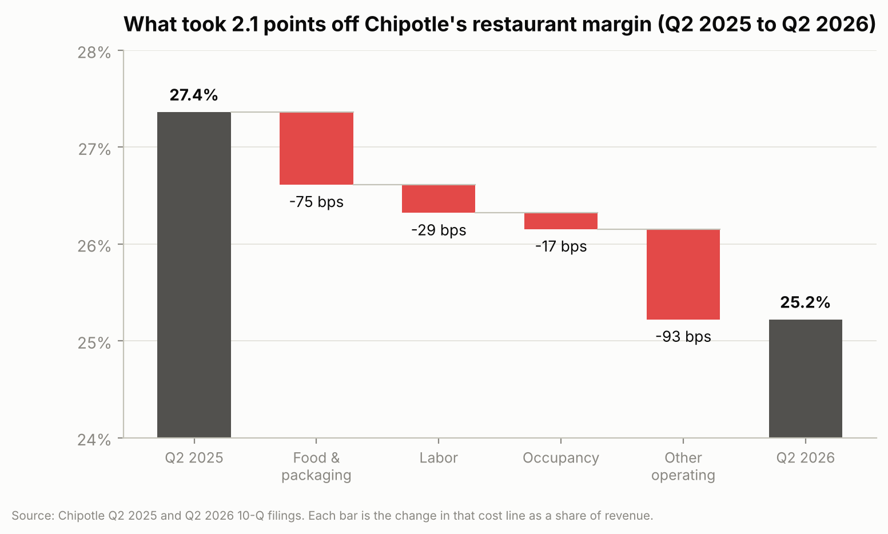
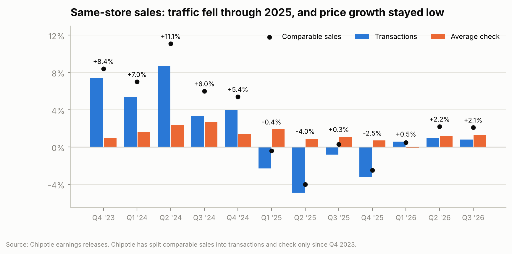
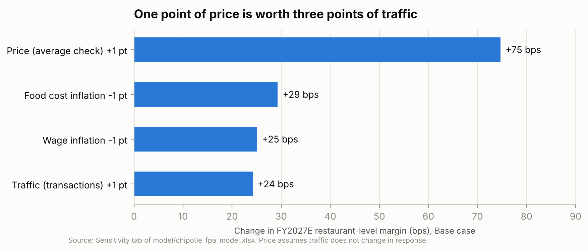
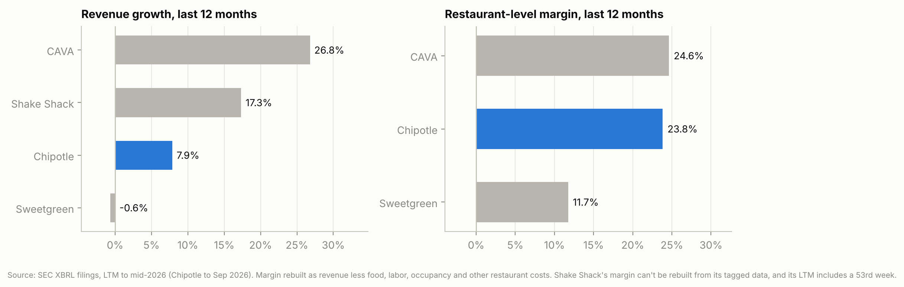

# Chipotle: 2027 margin budget and a Q3 2026 forecast

Chipotle's sales are growing again, but its restaurants are making less on
every dollar. Restaurant-level margin went from 28.9% in Q2 2024 to 25.2% in
Q2 2026, and customer traffic fell in every quarter of 2025. I wanted to work
through this the way a company's FP&A team would: build a driver-based model
from the public filings, put a number on next year's budget, figure out which
lever matters most, and then make a real forecast and see how close it gets.

Chipotle reports Q3 2026 on **October 28, 2026**. I made my forecast for that
quarter on October 15 and published it on [Tableau Public](https://public.tableau.com/app/profile/likhit.vardhan.chiliveri/viz/ChipotleFPA-2027MarginBudgetandQ32026Forecast/ChipotleFPA) on
October 16, so the date is on record outside this repo. The actual results get
scored against it below.

This is an independent analysis of public SEC filings. I'm not affiliated with
Chipotle, and nothing here is investment advice.

- **Excel model:** [`model/chipotle_fpa_model.xlsx`](model/chipotle_fpa_model.xlsx)
  (start on the Cover tab; switch scenarios on Assumptions)
- **One-page memo:** [`docs/memo_2027_budget.md`](docs/memo_2027_budget.md)
- **Q3 forecast and reasoning:** [`docs/q3_2026_forecast.md`](docs/q3_2026_forecast.md)
- **KPI tree and definitions:** [`docs/kpi_tree.md`](docs/kpi_tree.md)

## Q3 2026 scorecard

| | My forecast | Chipotle's guidance | Actual | Variance |
|---|---|---|---|---|
| Comparable sales | +1.0% | about +1% | *Oct 28* | |
| Revenue | $3,263M | | | |
| Restaurant-level margin | 23.4% | ~23.6% implied | | |
| Diluted EPS | $0.27 | | | |

## What I found

**1. Margins have been falling for two years, and the Base case doesn't get
them back in 2027.** Restaurant-level margin was 26.7% in 2024, 25.4% in 2025,
and I have it at 23.6% for 2026 and 23.1% for 2027. The Upside case reaches
24.9%; the Downside drops to 20.1%. EPS still grows in the Base case ($1.09 in
2026 to $1.23 in 2027) because of new restaurants and buybacks.



**2. Over the last year, marketing and delivery costs did more damage than
beef.** Between Q2 2025 and Q2 2026, margin fell 2.1 points. Other operating
costs took 93 bps of that and food took 75 bps.



**3. The sales problem is traffic, and price hasn't made up for it.** Comparable
transactions fell 2.3%, 4.9%, 0.8% and 3.2% across 2025. Average check grew
only 0.7-1.9% a quarter, because Chipotle has kept pricing below the industry
(restaurant prices nationally are up 3.5% in the last year).



**4. Price is the lever that matters most.** One more point of average check
adds about 75 bps to 2027 margin. One more point of traffic adds 24 bps, food
cost 1 point lower adds 29, wages 1 point lower add 25. Getting back to 2025's
margin would take check growth of about 5.3% (the Base case has 2.0%) or about
12% traffic growth. Price keeps paying off unless each point of it costs more
than about three points of traffic.



**5. Chipotle's margin lead over CAVA is gone.** Over the last twelve months
Chipotle's restaurant-level margin was 24.1% and CAVA's was 24.6%, with CAVA
growing 27% against Chipotle's 7%.



The memo turns this into five recommendations for the 2027 budget.

## How the model works

Revenue = average restaurants x revenue per restaurant. Revenue per restaurant
grows with comparable sales (transactions and average check) less about 1.3
points a year, because new restaurants open below the system average.

Each restaurant cost line starts from the same quarter last year (so
seasonality is kept) and moves with its own inflation, with price, and with
volume. For example, food cost % = last year's % x (1 + food inflation) /
(1 + check growth). Labor and other operating costs are part fixed and part
variable, so falling traffic pushes them up as a share of sales. The full map
is in [`docs/kpi_tree.md`](docs/kpi_tree.md).

Every forecast input sits on the `Assumptions` tab with the reason for the
number next to it, mostly from management's July 29 call and from cost trends
backed out of the filings. One cell switches between Base, Upside and Downside.

| Tab | What's on it |
|---|---|
| Assumptions | Scenario switch and every input, with its reasoning |
| Model | Quarterly drivers, restaurant P&L and EPS, Q1 2025 to Q4 2027 |
| Q3_Forecast | Locked Q3 forecast, management guidance, actuals and variance |
| Margin_Bridge | Cost-line bridges for history and forecast |
| Sensitivity | Margin by traffic, price, food and wage assumptions; lever ranking |
| Scenarios | Base, Upside and Downside side by side |
| Peers | Chipotle, CAVA, Sweetgreen, Shake Shack on one margin definition |
| Hist | 22 quarters as filed, plus derived ratios and tie-outs |
| Checks | 14 checks; all must pass |

## Checking the numbers

The 22 quarters of history tie to the earnings releases line by line (447
checks in `src/check_data.py`), my restaurant-level margin matches the one
Chipotle reports in all 20 quarters where it states one, and the workbook's own
Checks tab must read ALL CHECKS PASS. I also rebuilt the Base forecast
separately in Python; it matches the Excel output exactly. Details and
limitations: [`docs/data_and_checks.md`](docs/data_and_checks.md).

## Files

```
src/
  fetch_data.py       download SEC filings, earnings releases and BLS data
  sec_tables.py       read tables out of SEC HTML filings
  extract_cmg.py      quarterly P&L, restaurant counts, comps split
  extract_peers.py    last-twelve-month peer figures
  check_data.py       tie-outs against the earnings releases
  build_model.py      writes the Excel model
  run_model.py        recalculates it per scenario and saves outputs
  recalc.py           LibreOffice recalculation and formula-error scan
  make_charts.py      README charts
data/processed/       tidy CSVs used by the model
model/                the Excel model
output/               locked Q3 forecast, quarterly model output, scenarios, levers
docs/                 memo, forecast note, KPI tree, data notes
images/               charts
```

## Running it

```
python -m venv .venv
.venv/bin/pip install -r requirements.txt
cp .env.example .env            # add your name and email; the SEC requires it
.venv/bin/python run_all.py
```

Rebuilding the workbook needs LibreOffice installed (it recalculates the
formulas). Everything else is plain Python.
