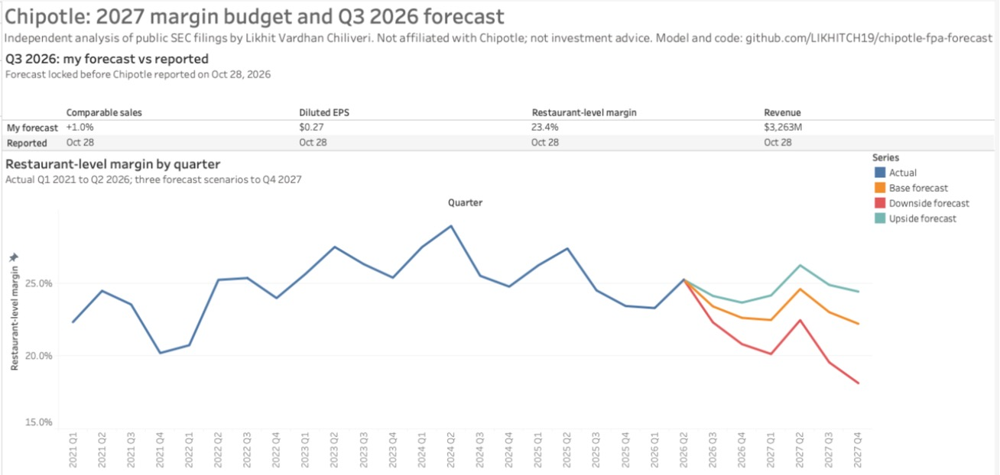

# Chipotle: 2027 margin budget and a Q3 2026 forecast

Chipotle's sales are growing again, but its restaurants are making less on
every dollar. Restaurant-level margin went from 28.9% in Q2 2024 to 25.2% in
Q2 2026, and customer traffic fell in every quarter of 2025. I wanted to work
through this the way a company's FP&A team would: build a driver-based model
from the public filings, put a number on next year's budget, figure out which
lever matters most, and then make a real forecast and see how close it gets.

I made a forecast for Q3 2026 on October 15 and published it on
[Tableau Public](https://public.tableau.com/app/profile/likhit.vardhan.chiliveri/viz/ChipotleFPA-2027MarginBudgetandQ32026Forecast/ChipotleFPA)
on October 16, twelve days before Chipotle reported on October 28. The
dashboard's publish date is the record of that; this repo went up after the
results. Restaurant-level margin came in at 23.3% against my 23.4%, and EPS at
$0.27, as forecast. After the results I rolled the model forward to a new
forecast for Q4 2026 and 2027.

This is an independent analysis of public SEC filings. I'm not affiliated with
Chipotle, and nothing here is investment advice.

- **Excel model:** [`model/chipotle_fpa_model.xlsx`](model/chipotle_fpa_model.xlsx)
  (start on the Cover tab; switch scenarios on Assumptions)
- **One-page memo:** [`docs/memo_2027_budget.md`](docs/memo_2027_budget.md)
- **Q3 forecast and reasoning:** [`docs/q3_2026_forecast.md`](docs/q3_2026_forecast.md)
- **Q3 variance write-up:** [`docs/q3_2026_variance.md`](docs/q3_2026_variance.md)
- **KPI tree and definitions:** [`docs/kpi_tree.md`](docs/kpi_tree.md)
- **Dashboard:** [Tableau Public](https://public.tableau.com/app/profile/likhit.vardhan.chiliveri/viz/ChipotleFPA-2027MarginBudgetandQ32026Forecast/ChipotleFPA)
  (as published on Oct 16, before the results; workbook in [`tableau/`](tableau/))

[](https://public.tableau.com/app/profile/likhit.vardhan.chiliveri/viz/ChipotleFPA-2027MarginBudgetandQ32026Forecast/ChipotleFPA)

## Q3 2026 scorecard

| | My forecast (Oct 15) | Chipotle's guidance (Jul 29) | Actual (Oct 28) | Variance |
|---|---|---|---|---|
| Comparable sales | +1.0% | about +1% | +2.1% | +112 bps |
| Revenue | $3,263M | | $3,293M | +0.9% |
| Restaurant-level margin | 23.4% | ~23.6% implied | 23.3% | -7 bps |
| Diluted EPS | $0.27 | | $0.27 | -$0.004 |

The margin was close partly by luck: traffic beat my forecast (+0.8% vs -1.1%)
while average check fell short (+1.3% vs +2.1%), and food came in 40 bps
better while marketing and delivery came in 39 bps worse. The line-by-line
explanation is in [`docs/q3_2026_variance.md`](docs/q3_2026_variance.md).

I also checked the driver model against two forecasts that only use past
quarters. It was the most accurate on both revenue and margin:

| Q3 2026 forecast | Revenue error | Margin error |
|---|---|---|
| Driver model (Oct 15) | -0.9% | 7 bps |
| Holt-Winters | -1.1% | 24 bps |
| Seasonal naive | -2.1% | 117 bps |

## Reforecast after Q3

With Q3 in the actuals and management's Oct 28 guidance for Q4, the model now
forecasts Q4 2026 to Q4 2027. The Oct 15 budget's outputs are kept in
[`output/budget_oct15/`](output/budget_oct15/).

| Base case | Oct 15 budget | Oct 30 reforecast |
|---|---|---|
| FY2026 restaurant-level margin | 23.6% | 23.4% |
| FY2027 restaurant-level margin | 23.1% | 22.4% |
| FY2027 comparable sales | +3.3% | +3.0% |
| FY2026 diluted EPS | $1.09 | $1.05 |
| FY2027 diluted EPS | $1.23 | $1.15 |

About half of the 2027 drop is price. On the Q3 call management said pricing
near 2% is "just not looking like" it will happen in 2027, so the Base case now
has average check growth of 1.5% against 2.0% before (about -40 bps). The rest
comes from starting higher on costs: Q3 other operating costs ran at 16.0% of
sales, and the model builds each 2027 quarter off the same quarter of 2026.
Management called a mid-24% margin the 2027 baseline, but that assumes pricing
keeps up with cost inflation. My Base case doesn't, which is the main reason
it sits about two points lower. The Upside case (2% check growth, lower cost
inflation) reaches 23.9%.

## What I found

**1. Margins have been falling for two years, and the Base case doesn't get
them back in 2027.** Restaurant-level margin was 26.7% in 2024 and 25.4% in
2025. After Q3 I have it at 23.4% for 2026 and 22.4% for 2027. The Upside case
reaches 23.9%; the Downside drops to 20.6%. EPS still grows in the Base case
($1.05 in 2026 to $1.15 in 2027) because of new restaurants and buybacks.


**2. Over the last year, marketing and delivery costs did more damage than
beef.** Between Q2 2025 and Q2 2026, margin fell 2.1 points. Other operating
costs took 93 bps of that and food took 75 bps.


**3. The sales problem was traffic, and price hasn't made up for it.**
Comparable transactions fell 2.3%, 4.9%, 0.8% and 3.2% across 2025. They have
been positive for three quarters since (+0.6%, +1.0%, +0.8%), but average check
grew only 0.7-1.9% a quarter, because Chipotle has kept pricing below the
industry (restaurant prices nationally are up 3.5% in the last year) and
promotions are eating into the price it does take.


**4. Price is the lever that matters most.** One more point of average check
adds about 76 bps to 2027 margin. One more point of traffic adds 24 bps, food
cost 1 point lower adds 29, wages 1 point lower add 25. Getting back to 2025's
margin would take check growth of about 5.5% (the Base case has 1.5%) or more
than 12% traffic growth. Price keeps paying off unless each point of it costs
more than about three points of traffic.


**5. Chipotle's margin lead over CAVA is gone.** Over the last twelve months
Chipotle's restaurant-level margin was 23.8% (to September) and CAVA's was
24.6% (to July), with CAVA growing 27% against Chipotle's 8%.


The memo turns this into five recommendations for the 2027 budget.

## How the model works

Revenue = average restaurants x revenue per restaurant. Revenue per restaurant
grows with comparable sales (transactions and average check) less about 1.3
points a year, because new restaurants open below the system average.

Each restaurant cost line starts from the same quarter last year (so
seasonality is kept) and moves with its own inflation, with price, and with
volume. For example, food cost % = last year's % x (1 + food inflation) /
(1 + check growth). Labor and other operating costs are part fixed and part
variable, so falling traffic pushes them up as a share of sales. The full map
is in [`docs/kpi_tree.md`](docs/kpi_tree.md).

Every forecast input sits on the `Assumptions` tab with the reason for the
number next to it, mostly from management's Oct 28 call and from cost trends
backed out of the filings. One cell switches between Base, Upside and Downside.

| Tab | What's on it |
|---|---|
| Assumptions | Scenario switch and every input, with its reasoning |
| Model | Quarterly drivers, restaurant P&L and EPS, Q1 2025 to Q4 2027 |
| Q3_Forecast | Locked Q3 forecast, management guidance, actuals, variance and reasons |
| Margin_Bridge | Cost-line bridges for history and forecast |
| Sensitivity | Margin by traffic, price, food and wage assumptions; lever ranking |
| Scenarios | Base, Upside and Downside side by side |
| Peers | Chipotle, CAVA, Sweetgreen, Shake Shack on one margin definition |
| Hist | 23 quarters as filed, plus derived ratios and tie-outs |
| Checks | 14 checks; all must pass |

## Checking the numbers

The 23 quarters of history tie to the earnings releases line by line (468
checks in `src/check_data.py`), my restaurant-level margin matches the one
Chipotle reports in all 21 quarters where it states one, and the workbook's own
Checks tab must read ALL CHECKS PASS. For the Oct 15 budget I also rebuilt the
Base forecast separately in Python, and it matched the Excel output exactly. Details and
limitations: [`docs/data_and_checks.md`](docs/data_and_checks.md).

## Files

```
src/
  fetch_data.py       download SEC filings, earnings releases and BLS data
  sec_tables.py       read tables out of SEC HTML filings
  extract_cmg.py      quarterly P&L, restaurant counts, comps split
  extract_peers.py    last-twelve-month peer figures
  check_data.py       tie-outs against the earnings releases
  build_model.py      writes the Excel model
  run_model.py        recalculates it per scenario and saves outputs
  recalc.py           LibreOffice recalculation and formula-error scan
  make_charts.py      README charts
  make_tableau_data.py  data for the Tableau dashboard
  baseline_forecast.py  statistical Q3 forecasts to compare against
  score_forecast.py   Q3 forecast vs actual
data/processed/       tidy CSVs used by the model
model/                the Excel model
output/               locked Q3 forecast, variance, model output, scenarios, levers
output/budget_oct15/  the Oct 15 budget's outputs, before the reforecast
tableau/              the Tableau workbook (as published Oct 16)
docs/                 memo, forecast note, variance write-up, KPI tree, data notes
images/               charts
```

## Running it

```
python -m venv .venv
.venv/bin/pip install -r requirements.txt
cp .env.example .env            # add your name and email; the SEC requires it
.venv/bin/python run_all.py
```

Rebuilding the workbook needs LibreOffice installed (it recalculates the
formulas). Everything else is plain Python.
