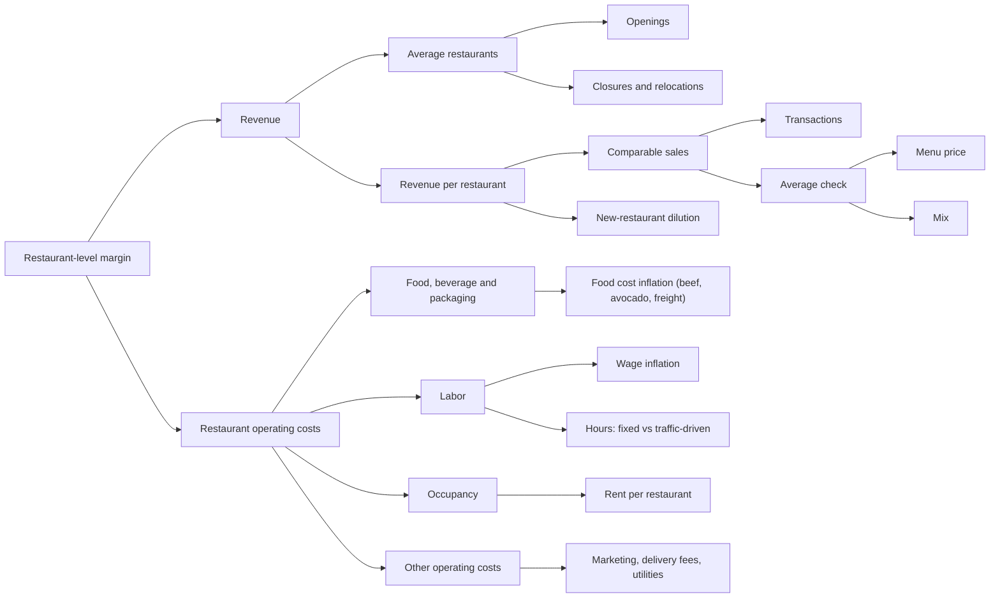

# KPI tree and definitions

The model is built around one output, restaurant-level margin, and the handful
of drivers underneath it. This page is the map: what each KPI means, how it's
calculated, where the number comes from, and where it lives in the workbook.

Price shows up twice on purpose: it raises revenue per restaurant, and it
spreads every cost line over a bigger check. That is why one point of price
moves margin about three times as much as one point of traffic.

## Definitions

| KPI | Definition | How it's calculated | Source | Workbook |
|---|---|---|---|---|
| Restaurant-level margin | Profit from running the restaurants, before corporate costs | 1 - (food + labor + occupancy + other operating) / revenue | 10-Q/10-K income statement; Chipotle reports the same measure (non-GAAP) | `Model` row "Restaurant-level margin"; tied to reported figures on `Hist` |
| Comparable sales | Sales growth at restaurants open at least 13 full months | (1 + transactions) x (1 + average check) - 1 | Earnings releases | `Model`, `Hist` |
| Transactions | Change in the number of orders at comparable restaurants | Reported | Earnings releases (split disclosed since Q4 2023) | `Hist`, `Assumptions` |
| Average check | Change in spend per order: menu price plus mix | Reported | Earnings releases | `Hist`, `Assumptions` |
| Average restaurants | Restaurants open on average in the quarter | (start of quarter + end of quarter) / 2 | Unit table in earnings releases | `Model` |
| Revenue per restaurant | Quarterly revenue per average restaurant | Revenue / average restaurants | Calculated | `Model`, `Hist` |
| New-restaurant dilution | How much slower revenue per restaurant grows than comps, because new restaurants open below the system average | (1 + revenue per restaurant growth) / (1 + comps) - 1 | Calculated; averaged -1.3% over the last eight quarters | `Hist`, `Assumptions` |
| Food cost % | Food, beverage and packaging as a share of revenue | Last year's % x (1 + food inflation) / (1 + check growth) | 10-Q/10-K; BLS beef prices for context | `Model` |
| Labor % | Restaurant wages, benefits and bonuses as a share of revenue | Last year's % x (1 + wage inflation) x (1 + variable share x volume change) / (1 + revenue per restaurant growth) | 10-Q/10-K; BLS food-service wages for context | `Model` |
| Occupancy % | Rent and related costs as a share of revenue | Last year's % x (1 + rent growth) / (1 + revenue per restaurant growth) | 10-Q/10-K | `Model` |
| Other operating % | Marketing, delivery fees, utilities, repairs and similar | Same logic as labor, with 40% treated as fixed | 10-Q/10-K | `Model` |
| Operating margin | Profit after G&A, D&A, pre-opening and impairment | Income from operations / revenue | 10-Q/10-K | `Model` |
| Diluted EPS | Net income per diluted share | Net income / diluted shares | 10-Q/10-K (pre-June 2024 shares adjusted for the 50-for-1 split) | `Model` |

## What I'd put on a monthly dashboard

If I were tracking this from inside the company, these are the six numbers I'd
want every month, because each one maps straight to a lever in the model:

1. Transactions vs last year
2. Average check vs last year, split into price and mix
3. Food cost per transaction
4. Labor hours per restaurant (and wage rate)
5. Other operating cost per restaurant, with marketing broken out
6. New-restaurant sales vs the system average
